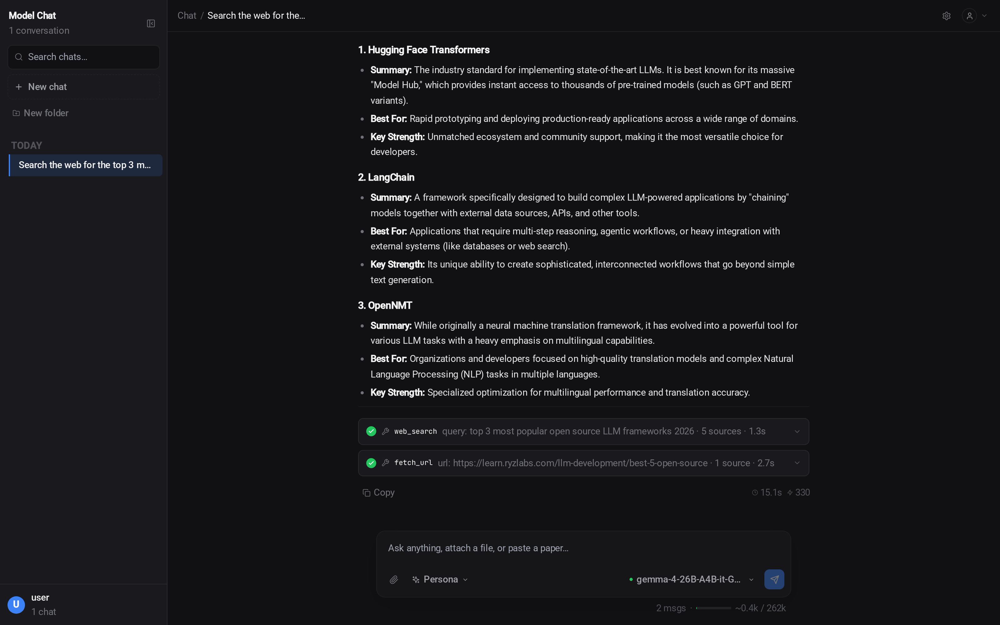
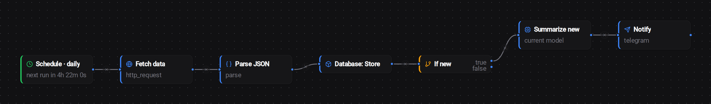

# Open Source Model Manager

> **A Production-Ready MLOps Platform for Large Language Models**

Containerized platform for serving and managing LLMs with dual backend support, web UI, chat interface, an autonomous AI agent system, and an [omp (omp.sh)](https://omp.sh) terminal coding agent that talks to it over the OpenAI-compatible endpoint.

<p align="center">
  <a href="https://www.docker.com/"></a>
  <a href="LICENSE"></a>
  <a href="https://developer.nvidia.com/cuda-toolkit"></a>
  <a href="https://nodejs.org/"></a>
  <a href="https://www.python.org/"></a>
  <a href="https://omp.sh"></a>
</p>

---

## Features

### Inference Engines

Each model is **routed to the engine that suits it**: its format, its family and this machine's CPU, RAM and GPUs. When a model has been measured on more than one engine here, the faster one wins. The load dialogs show the recommendation and why, and the **Inference engines** card on the Models tab lists what is installed and which updates are available.

| Backend | GPU Requirement | Best For |
|---------|-----------------|----------|
| **llama.cpp** | Maxwell 5.2+ (GTX 900, Quadro M4000) | GGUF models, older GPUs, CPU offload, single-stream chat, **Multi-Token Prediction (MTP) & draft-model speculative decoding** for 1.5–2× tok/s on DeepSeek-V3/R1, Qwen3-Next-MTP, and Qwen3.5/3.6-MTP variants |
| **sglang** | Turing 7.5+ (RTX 20-series, T4) — driver R580+ | High-throughput concurrent serving, RadixAttention prefix caching, GGUF + safetensors + AWQ/GPTQ/FP8/NVFP4, native `--tool-call-parser` and `--reasoning-parser` for Qwen / DeepSeek / GLM / Kimi / Llama-3/4 / Mistral / GPT-OSS |
| **vLLM** (optional) | Turing 7.5+ (RTX 20-series, T4) | Hugging Face weights, the widest architecture coverage, mixed-precision compressed-tensors checkpoints |
| **Strata** (optional) | Turing 7.5+ with driver 580+ | Very large MoE models on consumer hardware, such as **Qwen3.8-Flash-Next** (125B parameters, about 6B active per token): the busiest experts stay on the GPU and the rest in RAM. On a CPU without AVX2 it uses a source-built SSE4.2 engine, which upstream marks experimental |

Each model can be **pinned to specific GPUs** at load time. By default a model is given every card and llama.cpp splits it across them — which buys VRAM, not speed, since a layer split runs the cards in sequence. Pinning one model to a subset leaves the others free to run a second model at full speed, which is what makes the two-model pairing above pay off. The load dialog shows each card's free VRAM and what already occupies it.

### Core Capabilities

- **HuggingFace Integration** — Search and download GGUF models directly
- **Auto-Configuration** — Optimal settings based on hardware detection
- **Real-time Monitoring** — WebSocket-based live logs, status, and download progress
- **Multi-User Support** — Authentication with session management and API keys
- **OpenAI-Compatible API** — Drop-in replacement for OpenAI endpoints
- **Vision Models** — Send images to vision-capable models (LLaVA, Qwen-VL) with OCR fallback for non-vision models
- **Thinking Models** — Parse and display reasoning from models like DeepSeek R1 and Qwen QwQ
- **Audio Transcription** — Built-in `transcribe_audio` skill (faster-whisper, bundled `small.en` model, CPU-only, runs in the sandbox)
- **Spreadsheets & SQL in chat** — `read_xlsx` (openpyxl) and `query_sqlite` skills let the model read XLSX files and run SELECTs (or DDL with `readonly=false`) against SQLite databases in the workspace
- **Document Generation** — `create_pdf` and `create_docx` skills render Markdown (including GFM tables) to PDF/DOCX, persisted to `/workspace/artifacts/`; a `contentFile` param accepts large input that would exceed the tool-arg token cap
- **Image Editing** — `transform_image` skill (Pillow) for resize, crop, thumbnail, rotate, format-convert, and grayscale operations
- **Auto-Download Chips** — Any file a sandboxed skill writes to `/workspace/artifacts/` is auto-promoted into a download chip in the chat (mtime-filtered so prior turns don't re-surface); `make_downloadable` promotes existing workspace files explicitly
- **Map-Reduce Chunking** — Automatically splits large content across multiple model calls and synthesizes results
- **AIMem Memory Compression** — Compresses older conversation history to reduce token usage, speeding up inference and lowering VRAM consumption during long conversations
- **Account Memory & Persona** — The assistant learns per account: preferences, durable facts, and *experience* (the tool path that worked for each kind of task), consolidating instead of sprawling and injecting only what's relevant each turn. Shared across the web chat and omp; browse/edit/clear it in the **Memory** tab
- **Background Streaming** — Responses continue server-side if you navigate away, saved on completion
- **Auto-Continuation** — Automatically continues truncated responses up to 8 times

### Two Models, One Task

Load two models and they work a single request together instead of taking turns. Configure the pair on the **My Models** page (**Model roles**) or per-account in the chat's Settings:

- **Primary** — your everyday model. It answers every turn on its own, so a quick question stays quick.
- **Secondary** — the model you trust with hard work. It stays out of the way until the ask is substantial (building something, analysing a file or repo, security work, multi-step research), then **takes the lead and writes the answer itself**.

When the secondary takes over, the two run genuinely concurrently on their own GPUs:

1. The **primary** spends a few seconds sizing up the task and hands over a short brief, including a list of background jobs worth running in parallel.
2. The **secondary** writes the answer.
3. While it writes, those jobs run **back on the primary** — look something up, read or list files, run a script and report back. The secondary never waits; each result is delivered into its context the moment it lands, and it can dispatch more at any time.
4. Optionally the secondary **reviews** answers the primary wrote alone, adding a note or handing back a corrected version.

The chat shows who is doing what: one live row per model that is currently working, with its own activity and a running clock, the model name on every tool chip, and `Assistant · <model>` on the finished message. Everything is visible in the transcript afterwards, including each background job and the tools it ran.

Pairs work **across backends** — a llama.cpp model and an sglang model can be primary and secondary in either direction.

### Parallel Worker Agents

The chat can fan a request out to several worker agents at once via the `delegate` tool — each a full turn with its own tools — and synthesize their reports. Workers are placed by **measured decode speed** across every loaded model: the platform probes each model's tok/s and solves for the shortest finish time rather than blindly spreading one worker per model (on mixed hardware, handing a worker to a much slower model makes the whole turn slower). A second chat message also starts immediately on a free slot instead of queueing behind the first.

### Native Tool Calling

The chat model can invoke tools on its own via OpenAI-style function calls. Every enabled skill in your workspace is surfaced to the model as a named tool; the UI renders each call as an inline chip showing the tool name, arguments, and (on click) the full result. There are no "web search" or "URL fetch" toggles anymore — the model decides when to reach for them.

- **Catalog built from your skill registry** — toggling a skill off in Settings removes it from the tool catalog the model sees on the next turn
- **Semantic tool router** — the 130+ tool catalog is trimmed per turn to the tools relevant to the request (embedding-based top-K plus intent rules), so even small local models see a focused, reliable catalog
- **Streamed tool chips** — the server streams `tool_call_delta` while the model composes the call, then `tool_executing` on dispatch and `tool_result` when it returns, so each chip renders live below the assistant message while the model works (`native_tool_call` is the chip type persisted on the saved message, not a stream event)
- **Multi-round reasoning** — the model can call several tools in sequence and see each result before responding
- **One `web` tool for retrieval** — search and read pages (including JS-rendered, dynamic, and bot-protected sites) through a single consolidated tool that routes internally to the search engines (DuckDuckGo → Scrapling → Brave → Playwright), direct file download (PDF/DOCX/XLSX), Scrapling stealth fetch, Playwright full-browser rendering with XHR interception, page interaction, and multi-page crawling
- **Media & data tools** — `find_image` (searched or extracted images rendered as inline thumbnail grids, every URL liveness-probed; also takes page screenshots), `find_video` (click-to-play inline players, including HLS streams), `sniff_media_streams` (DevTools-style network inspection to find the stream URLs a JS player loads), `render_chart` (inline Recharts), `fetch_timeseries` (Yahoo Finance quotes/history)
- **Analysis & security tools** — `dns_lookup`, `virustotal_lookup`, `base64_decode`, `extract_strings` (printable-string extraction from binaries), `extract_archive` (zip/tar/gz/bz2/xz with magic-byte detection), plus every built-in skill (file ops, git, code navigation, system info, OCR, PDF, email parsing, and more)
- **Self-improving** — a `record_learning` tool lets the model save outcome-aware lessons and per-task recipes into account memory, so repeat tasks use fewer tool calls
- **No silent dead-ends** — if the tool-iteration cap is reached, the model still returns a final user-visible message

### Web Scraping & Search

- **[Scrapling](https://github.com/D4Vinci/Scrapling) Integration** — CAPTCHA-evading web scraping with StealthyFetcher
- **Multi-Engine Search** — DuckDuckGo → Scrapling → Brave Search → Playwright
- **Smart Content Extraction** — Playwright SPA/XHR interception, direct file download for PDFs/DOCX/XLSX
- **JS-shell-aware cascade** — the fetch pipeline detects SPA app-shells in the raw HTML and escalates to a real browser only when needed, so static pages stay fast and client-rendered apps still return real content
- **Bot-wall fast-fail** — hosts whose protection defeats every layer are remembered for a few minutes and fail instantly with guidance to use a different site, instead of re-burning the full fallback chain on URL variants

### AIMem — Memory Compression

Long conversations consume increasing amounts of context window and VRAM. AIMem compresses older messages before they're sent to the model, reducing token count while preserving all factual content.

- **4-stage pipeline** — Semantic deduplication, lossy prompt compression, symbolic shorthand, and relevance-gated retrieval
- **~48% token reduction** with 100% fact retention (benchmarked across 47 strategy combinations)
- **Faster responses** — Fewer input tokens means faster time-to-first-token and lower VRAM pressure
- **Transparent** — Enable per-model via the "Compress Memory" toggle in the model manager; all clients (Chat UI, API) respect the setting automatically
- **Smart triggering** — Only activates when conversations have 6+ messages and input exceeds 60% of available context, keeping short conversations untouched

### Chat Interface

Lightweight React + Tailwind CSS chat UI at `https://localhost:3002`:

- Native tool-call chips rendered inline with each assistant message
- Inline media from tool results — image thumbnail grids, click-to-play video players (including HLS via hls.js), and Recharts charts
- Queue follow-up messages while the model is still streaming — a new topic starts straight away in its own window on a free slot, a follow-up waits for the current reply so it has the full context
- Per-model attribution: which model wrote the answer, which made each tool call, and live rows for both models when a pair is working
- **Reasoning effort** control (off / low / medium / high) per message, using each model's native lever where it has one
- 18 themes and 6 chat layouts (Default, Centered, Timeline, Bubbles, Slack, Minimal)
- 54 font choices with dynamic Google Fonts loading
- Clipboard image paste and drag-and-drop file attachments
- Paste-as-file for large text (500+ chars auto-converted to attachment)
- Email file parsing (.eml, .msg) with nested attachment extraction
- Archive uploads (zip/tar/gz/bz2/xz) extracted into the conversation workspace for code/file analysis
- OCR text extraction for uploaded images via Tesseract

<p align="center">
  
</p>

<p align="center">
  <em>The model decides to call <code>web_search</code>, reads the results, and follows up with <code>scrapling_fetch</code> to pull a full page — each call appears as a clickable chip below the response.</em>
</p>

### omp (omp.sh) — Terminal UI

The terminal experience for this project is **[omp](https://omp.sh)** (oh-my-pi), a third-party coding agent — a fork of Pi (pi.dev, which it replaces here) with a native core, shipped as one self-contained binary. We don't ship our own TUI, we wire omp in: one installer puts the prebuilt `omp` binary on your PATH (no Node or npm), drops in the bundled extension, and any model loaded in **My Models** becomes an omp-driven coding agent backed by the 130+ skills the webapp already exposes.

- **omp handles the local FS** — read/write/bash/edit/grep run on the user's `$PWD` via omp's built-ins, not on the server's `/workspace`
- **Skills surface as omp tools** — the bundled extension at `webapp/omp-extension/modelserver.ts` registers each enabled skill (`web_search`, `fetch_url`, `playwright_*`, `scrapling_fetch`, OCR, PDF, email parsing, …) and proxies execution to `/api/skills/:name/execute`
- **Real context window** — `/v1/models` is augmented server-side to inject the running instance's actual `context_window` (for a two-model pair, the window the pair can serve), so omp compacts against the loaded model's true ceiling
- **Real token usage** — `/v1/*` streaming requests inject `stream_options.include_usage: true` and tap the SSE for the final usage chunk, so per-key token counters update on every omp turn
- **Two models on one task** — with a primary/secondary pair configured, substantial omp tasks run on the stronger model while the faster one runs background jobs (`ask_assistant` / `await_assistant`); compaction summaries run on the fast model
- **Persistent shell & SSH sessions** — first-party tools (`ssh_connect`, `shell_open`, `shell_exec`, `shell_send`, `shell_read`, `shell_close`, `shell_list`) hold a real interactive PTY open across turns — SSH logins with password prompts, REPLs, `docker exec -it`, live `tail -f`, control keys (ctrl-c/-d/…) — with no native modules required (works even when the model server is unreachable)
- **Shared account memory** — omp turns read and write the same core memory as the web chat (create the bearer key while signed in so it's tied to your account)
- **Bearer-mode API key required** — the extension uses `Authorization: Bearer <key>`, so create a bearer-only key in the **API Keys** tab
- **Catalog sized to the model** — omp sends its whole tool catalog on every request, and the full skill set is ~27k tokens of schema and system prompt, which simply does not fit a small-context model. The extension budgets the catalog against the smallest loaded model's context window (`MODELSERVER_TOOL_BUDGET`, default 18%; `0` disables the cap) and trims in priority order — interpreters, file reading and search, fetch, archive and delivery tools first
- **Multi-model aware** — `/v1/models` lists every running instance; the extension registers them under their model names (`modelserver/<name>`), across both backends
- **Auto-config in Docs tab** ("omp setup") — the Linux/macOS/WSL and native-Windows install one-liners are pre-baked with your API key + endpoint

### Automation — Workflow Engine

A first-party visual **workflow engine** is built into the chat UI (the **Automation** button next to "+ New chat") — no external service, no extra container. Workflows drive the **locally served LLMs** and the same sandboxed skill catalog the chat uses, and run **manually, on a schedule, by webhook, on a system event, or from a Telegram/Slack message**.

<p align="center">
  
</p>

- **Build & edit with LLM** — describe the automation you want and the model assembles the nodes + wiring (**Build with LLM** under *New automation*); or open an existing one and **Edit with LLM** to apply a change in plain language — you preview the diff (added / changed / removed steps) before it saves.
- **Palette** — drag-and-drop nodes grouped into **Triggers** (Manual, Schedule, Webhook, On Event, Loop), **Tools** (Model, Web Search, Fetch URL, HTTP Request, Crawl Pages, Parse JSON, Render HTML/Chart, SQLite, Create PDF/File, **Run Python**, …), **Connectors** (Slack & Telegram — each with new-message trigger / send / get), and **Logic Gates** (If/Else, Switch, Filter, Merge, Delay, Set). A live search filters the palette.
- **Database nodes** — *Database: Store* keeps a persistent per-workflow SQLite collection; set a unique **key** (with optional ignore-words, normalize, and a comma-separated fallback like `link,post_title`) to deduplicate and emit only newly-seen records as `.new` — i.e. **change-tracking across runs**. *Database: Query* reads rows back (newest-first, or a raw `SELECT` a model can generate) to feed a model, Telegram, or a file.
- **Robust logic gates** — text operators (equals, contains, starts/ends with, regex, `>`, `<`, is-empty, …); a blank *Value to check* defaults to the previous node's output.
- **Data wiring** — reference any upstream step with `{{nodes.<id>.field}}` tags; the config panel lists clickable tags from all upstream nodes (with expected fields shown before a run). Independent non-LLM steps at the same depth run **in parallel**.
- **Runnable everywhere** — build it in the UI or drive it over the API: `POST /api/automations/:id/run-sync` for the final JSON, `POST /api/automations/:id/run` for live SSE frames, `POST /api/automations/:id/test` to test-run + self-repair a saved workflow, plus full CRUD under `/api/automations`. Persists to `/models/.modelserver/` — no database service required.

> **Example change-monitor:** `Schedule → HTTP Request (API) → Parse JSON → Database: Store (key) → If/Else (new is not empty) → Model → Telegram` — fetches a feed daily, stores it with a dedup key, and pings you only when genuinely-new items appear.

---

## Prerequisites

**Required:** Docker 24.0+ with Compose v2, Linux (Ubuntu 20.04+), 4GB RAM minimum (8GB+ recommended)

**Optional:** NVIDIA GPU with Container Toolkit, HuggingFace token (for gated models)

---

## Quick Start

```bash
# Clone and build
git clone https://github.com/frontierstack/Open-Source-Model-Manager.git
cd Open-Source-Model-Manager

# Optional: set HuggingFace token
echo "HUGGING_FACE_HUB_TOKEN=hf_xxx" > .env

# Build and start (~20-25 min first time)
./build.sh && ./start.sh
```

| Interface | URL |
|-----------|-----|
| Web UI | https://localhost:3001 |
| Chat UI | https://localhost:3002 |

### Access from other devices

Both services publish on `0.0.0.0`, so they are reachable at this machine's own
address (`https://<host-ip>:3001` / `:3002`) as well as at `localhost`.
`./start.sh` prints every working URL, live-checks each one, and puts the host's
IP addresses in the TLS certificate — without that the LAN URL fails with
`ERR_CERT_COMMON_NAME_INVALID` even though the port is open. If the certificate
predates the change, `./start.sh` refreshes it automatically (the old one is
kept as `certs/server.crt.bak`; browsers will ask to trust the new one once).

On a Linux host, allow the ports if a firewall is active:

```bash
sudo ufw allow 3001/tcp && sudo ufw allow 3002/tcp      # ufw
sudo firewall-cmd --add-port=3001/tcp --add-port=3002/tcp --permanent && sudo firewall-cmd --reload
```

**On WSL2 this needs one extra step** — see below.

### Updating

```bash
sudo ./update.sh                   # Pull from GitHub, rebuild only what changed, test, clean up
sudo ./update.sh --dry-run         # Show incoming commits + what would rebuild
sudo ./update.sh --stop-instances  # Also stop model instances (needed after a llamacpp/sglang rebuild)
```

The updater fast-forwards the checkout from GitHub (local edits to tracked
files are stashed and restored; `.env`, `certs/`, `models/` are never touched),
checksums every image's build inputs against the last recorded build, rebuilds
only the images whose inputs changed, recreates the containers, runs health and
"container code equals checkout" checks, and prunes the dangling images and
stale build cache left behind. A zip-download install (no `.git`) is turned
into a proper checkout on the first run. Works the same on native Linux and
WSL2 (Docker Desktop or the native daemon).

### Build Options

```bash
./build.sh                         # Parallel build (default)
./build.sh --no-parallel           # Sequential (low memory)
./build.sh --no-cache --no-resume  # Force full rebuild
```

### Optional Engines

Strata and vLLM are extra downloads, so they are not installed by default:

```bash
sudo ./engines.sh status                 # What is installed
sudo ./engines.sh install strata         # Strata (published image, or an SSE4.2 build on CPUs without AVX2)
sudo ./engines.sh install vllm           # vLLM (about 30 GB)
sudo ./build.sh --engines strata,vllm    # The same, as part of a full install
```

`./update.sh` keeps installed engines at the versions pinned in `webapp/services/engineVersions.json`. To run **Qwen3.8-Flash-Next**, install Strata and use the **Inference engines** card on the Models tab. The first start downloads 60 to 92 GB depending on the size, prepares the model, and needs that much free disk again for the prepared pack. It also needs enough free GPU memory, so unload other models first.

Keep `models/` on an SSD when using Strata: it reads a 28.8 GB lookup table from disk constantly, and on a hard drive it stalls and restarts.

### Windows + WSL2 Setup (no Docker Desktop)

If you're running on Windows via WSL2 and don't want Docker Desktop, `wsl-setup.sh` installs a real systemd-managed Docker Engine inside the distro so `./build.sh` and the gVisor sandbox both work natively:

```bash
sudo ./wsl-setup.sh                 # Auto-detect GPU, install gVisor
sudo ./wsl-setup.sh --no-gpu        # Skip nvidia-container-toolkit
sudo ./wsl-setup.sh --no-gvisor     # Skip gVisor runtime
sudo ./wsl-setup.sh --cleanup       # Wipe all containers/images/volumes (destructive)
sudo ./wsl-setup.sh --cleanup -y    # Same, no confirmation prompt
```

The script is idempotent. If it needs to enable systemd in `/etc/wsl.conf`, it prints the exact `wsl --shutdown` command to run from PowerShell and exits — re-run after the distro restart and it picks up where it left off.

**LAN access from other computers.** WSL2's default NAT networking forwards only
`localhost` into the distro, so published ports are invisible to the rest of the
network — this is the usual reason a fresh WSL install "only works on localhost".
Run:

```bash
sudo ./wsl-expose.sh                 # detect mode, then do the right thing
./wsl-expose.sh --status            # what's forwarded now (flags stale entries)
./wsl-expose.sh --use-mirrored      # switch to mirrored networking (durable fix)
./wsl-expose.sh --undo              # remove the forwards + firewall rule
./wsl-expose.sh --dry-run           # print the Windows commands, change nothing
```

In NAT mode it adds `netsh interface portproxy` rules plus one inbound firewall
rule (via an elevated PowerShell — expect a UAC prompt) and starts the IP Helper
service if it is stopped. Note the WSL VM IP changes on every `wsl --shutdown`,
which breaks the forwards; re-run the script, or switch to mirrored networking
once and forget about it. In mirrored mode it skips portproxy entirely (the VM
shares the Windows IP) and just opens the Windows and Hyper-V VM firewalls.

To set up mirrored networking by hand instead, create `%UserProfile%\.wslconfig`:

```ini
[wsl2]
networkingMode=mirrored
firewall=true
dnsTunneling=true
autoProxy=true

[experimental]
hostAddressLoopback=true
```

Then from PowerShell:

```powershell
wsl --shutdown
# After WSL restarts, open the firewall (Admin PowerShell):
New-NetFirewallRule -DisplayName "ModelServer 3001" -Direction Inbound -LocalPort 3001 -Protocol TCP -Profile Any -Action Allow
New-NetFirewallRule -DisplayName "ModelServer 3002" -Direction Inbound -LocalPort 3002 -Protocol TCP -Profile Any -Action Allow
# If WSL's Hyper-V firewall is gating traffic too:
Set-NetFirewallHyperVVMSetting -Name '{40E0AC32-46A5-438A-A0B2-2B479E8F2E90}' -DefaultInboundAction Allow
```

Mirrored mode requires Windows 11 build 22621+ and WSL 2.0.0+. On older Windows, use `netsh interface portproxy` rules instead.

---

## Usage

### Web Interface

1. Navigate to https://localhost:3001
2. Register account (first user = admin)
3. **Discover** — Search and download models
4. **My Models** — Launch and manage instances
5. **API Keys** — Generate access tokens
6. **Memory** — Browse and edit the assistant's account memory / persona
7. **Docs** — API code builder with 100+ endpoints in 4 languages

> Tip: drag the left-nav items to reorder them — your layout is saved per user.

### omp (omp.sh) — terminal coding agent

```bash
# Docs tab → "omp setup" shows this one-liner with your key filled in.
export MODELSERVER_API_KEY="<bearer-mode key from the API Keys tab>"
curl -fsSk -H "Authorization: Bearer $MODELSERVER_API_KEY" \
  https://localhost:3001/api/omp/install | bash && source ~/.bashrc

# Run from any project directory
omp                       # interactive
omp -p "Reply with OK"    # one-shot check
```

The installer puts the official prebuilt `omp` binary in `~/.local/bin` (no Node/npm/Bun), the extension in `~/.omp/agent/extensions/modelserver/`, and sets the server's models as omp's default roles in `~/.omp/agent/config.yml`. Native Windows (no WSL, no admin): the Docs tab's PowerShell one-liner runs `/api/omp/install.ps1`. The old `/api/pi/install` links still work and now install omp; `OMP_INSTALL_REMOVE_PI=1` also removes an old Pi install.

The extension auto-fetches the user's enabled skills on startup and registers each as an omp tool, so the 130+ default skills (web search, URL fetch, code navigation, file ops, OCR, PDF, email parsing, …) are available without further configuration. omp handles the local FS via its built-in `read`/`bash`/`edit`/`write`; the modelserver tools target server-side concerns (web, attachments, sandbox runs) so the two don't shadow each other. Details: [`webapp/omp-extension/README.md`](webapp/omp-extension/README.md).

> **Set the env vars before `omp`.** The extension reads `MODELSERVER_API_KEY` (a **bearer-mode** key from the API Keys tab) and `MODELSERVER_BASE_URL` at startup — without the key it skips provider + skill registration. The installer appends `MODELSERVER_BASE_URL` to your shell rc, but keep `MODELSERVER_API_KEY` exported in your shell (don't commit it).
>
> **Troubleshooting — `401` on the model call** (but skills still work): a stale extension. omp reads a provider `apiKey` as an environment-variable NAME (`MODELSERVER_API_KEY`); the Pi-era `$MODELSERVER_API_KEY` form is sent literally. Re-run the installer to refresh the extension.

### API

OpenAI-compatible endpoints work with any OpenAI SDK client:

```bash
curl -sk https://localhost:3001/v1/chat/completions \
  -H "Authorization: Bearer YOUR_API_KEY" \
  -H "Content-Type: application/json" \
  -d '{"model": "model-name", "messages": [{"role": "user", "content": "Hello!"}]}'
```

```python
from openai import OpenAI
client = OpenAI(base_url="https://localhost:3001/v1", api_key="YOUR_API_KEY")
response = client.chat.completions.create(
    model="model-name",
    messages=[{"role": "user", "content": "Hello!"}]
)
```

---

## Configuration

### Environment Variables

```bash
HUGGING_FACE_HUB_TOKEN=hf_xxx         # For gated model downloads
HOST_IP=192.168.1.100                  # Container networking (auto-detected)
HOST_MODELS_PATH=/mnt/d/models         # Override models path (Windows+WSL)
NODE_TLS_REJECT_UNAUTHORIZED=0         # SSL bypass for corporate proxies
SESSION_SECRET=your-secret             # Auto-generated if not set
```

### Ports

| Service | Port | Purpose |
|---------|------|---------|
| Webapp | 3001 | HTTPS — Management UI, REST API, WebSocket, OpenAI-compatible endpoints |
| Chat | 3002 | HTTPS — Lightweight chat-only interface (proxies to Webapp API); hosts the Automation workflow editor |
| Models | 8001+ | Model inference instances, bound to localhost only (not network-exposed) |

---

## Architecture

```
                    ┌───────────┐  ┌───────────┐  ┌───────────┐
                    │  Browser  │  │  Browser  │  │ Terminal  │
                    └─────┬─────┘  └─────┬─────┘  └─────┬─────┘
                          │              │              │
                        HTTPS          HTTPS          HTTPS
                          │              │              │
          ┌───────────────┼──────────────┼──────────────┼───────────────┐
          │               ▼              ▼              ▼               │
          │  ┌────────────────────┐ ┌──────────┐ ┌───────────────┐     │
          │  │   Webapp  :3001   │ │Chat :3002│ │  omp (omp.sh) │     │
          │  │                    │ │          │ │   Terminal UI │     │
          │  │  React Frontend    │ │ React +  │ └───────┬───────┘     │
          │  │  Express API       │ │ Tailwind │         │             │
          │  │  WebSocket Server  │ │ 18 Themes│   :3001/api           │
          │  │  130+ Skills Engine│ │ 6 Layouts│         │             │
          │  │  Native Tool Calls │ │Tool Chips│         │             │
          │  │  OpenAI Endpoints  │ │ OCR/File │         │             │
          │  │  Automation Engine │ │ Uploads  │         │             │
          │  │  Scrape/Map-Reduce │ └────┬─────┘         │             │
          │  │  Docker Integration│      │               │             │
          │  └─────────┬──────────┘      │               │             │
          │            │◄────────────────┘───────────────┘             │
          │            │                                               │
          │            ▼                                               │
          │  ┌──────────────────┐                                      │
          │  │  Docker Engine   │                                      │
          │  └────────┬─────────┘                                      │
          │           │                                                │
          │     ┌─────┴──────┐                                         │
          │     ▼            ▼                                         │
          │  ┌────────┐  ┌────────┐                                    │
          │  │llamacpp│  │ sglang │  Dynamic instances on :8001+       │
          │  │Maxwell │  │ Turing │  Bound to localhost only           │
          │  │ 5.2+   │  │  7.5+  │  Models mounted read-only          │
          │  └────┬───┘  └───┬────┘                                    │
          │       └─────┬────┘                                         │
          │             ▼                                               │
          │  ┌──────────────────┐                                      │
          │  │  NVIDIA GPU(s)   │                                      │
          │  │  CUDA 12.8/12.9  │                                      │
          │  │  Shared VRAM     │                                      │
          │  └──────────────────┘                                      │
          └────────────────────────────────────────────────────────────┘
```

**Data Persistence:** All user data stored in `./models/.modelserver/` as JSON files (agents, skills, conversations, API keys with AES-256-GCM encryption). Model containers mount `./models` read-only.

**Sandbox image:** Skills that run user-provided code (or any of the new media skills — `transform_image`, `transcribe_audio`, `read_xlsx`, `query_sqlite`, `make_downloadable`) execute inside a ~2.6GB gVisor-isolated sandbox image with `faster-whisper`, `ffmpeg`, Pillow, openpyxl, and a bundled `small.en` Whisper model preloaded.

**Automation Engine:** The visual workflow engine runs **in-process** inside the webapp — no extra service or container. It's a branch-pruning DAG executor (`webapp/services/automationEngine.js`) over a `{ nodes, edges }` graph with `{{...}}` data templating, reusing the same auth, sandboxed skills, and locally-served models. Triggers fire **manually, on a schedule** (one 5s `setInterval` tick, epoch-aligned intervals + cron), **by webhook, on a system event, or from a Telegram/Slack poll**; independent nodes at the same depth execute in parallel. Stateful nodes (`Database: Store`, `Track Changes`) keep per-workflow SQLite in a sandbox `automation-<id>` workspace for dedup/change-tracking across runs. An LLM **Build/Edit** path assembles workflows from a plain-language prompt and can **test-run and self-repair** them — running the graph, inspecting each node's output (and re-running to verify "only new/changed" logic) until the goal is met. Workflows, run history, and node types persist to `/models/.modelserver/` as JSON — no database service required.

---

## Troubleshooting

| Problem | Solution |
|---------|----------|
| Build fails / interrupted | `./build.sh` (auto-resumes) |
| Out of memory during build | `./build.sh --no-parallel` |
| Corrupted build state | `rm -rf .build-state/ && ./build.sh` |
| Model OOM errors | Reduce GPU layers, use q8_0/q4_0 cache type |
| Port 3001 in use | `netstat -tulpn \| grep 3001` to find conflict |
| GPU not detected | Reinstall NVIDIA Container Toolkit, test with `nvidia-smi` |
| SSL/corporate proxy errors | `echo "NODE_TLS_REJECT_UNAUTHORIZED=0" >> .env` |

```bash
# Common diagnostic commands
docker compose logs -f webapp       # View webapp logs
docker compose ps                   # Check service status
nvidia-smi                          # Check GPU
docker stats                        # Container resource usage
```

---

**omp returns nothing**
The model's context window is too small for the tool catalog. `omp -p --mode json` shows the error. The extension trims the catalog automatically — if you still hit it, lower `MODELSERVER_TOOL_BUDGET` or point omp at a larger model (`--model modelserver/<name>`).

**A model answers that isn't the one you asked for**
A `model` id that matches no running instance is served by the first one loaded. Check the server log for `matched no running instance` — it names what you sent and what is actually available. Use the exact id from `GET /v1/models`.

**sglang won't start, or starts with almost no KV cache**
`--mem-fraction-static` sets the *reserve* in sglang 0.5.17+, not the allocation — lowering it to "share a card" gives you **less** cache, and past a point a hard `ValueError`. To fit beside another model use roughly `1 - (free_VRAM - weights) / free_VRAM`, plus ~0.1.

## Documentation

- **[COMMANDS.md](COMMANDS.md)** — Complete command and feature reference
- **[Docs Tab](https://localhost:3001)** — Interactive API code builder (100+ endpoints, 4 languages)

---

## Contributing

1. Fork the repository
2. Create feature branch (`git checkout -b feature/name`)
3. Commit and push changes
4. Open Pull Request

---

## License

MIT License — see [LICENSE](LICENSE).

## Acknowledgments

[llama.cpp](https://github.com/ggerganov/llama.cpp) | [sglang](https://github.com/sgl-project/sglang) | [HuggingFace](https://huggingface.co/) | [omp (omp.sh)](https://omp.sh) — terminal coding agent | [Scrapling](https://github.com/D4Vinci/Scrapling) | [Playwright](https://playwright.dev/) | [Material-UI](https://mui.com/)

---

## Support

[GitHub Issues](https://github.com/frontierstack/Open-Source-Model-Manager/issues) | [GitHub Discussions](https://github.com/frontierstack/Open-Source-Model-Manager/discussions)

<div align="center">

**Built for the Open Source AI Community**

[Back to Top](#open-source-model-manager)

</div>
